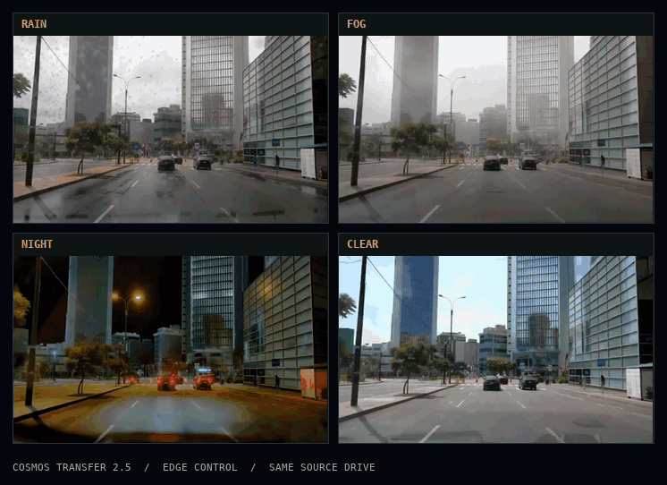
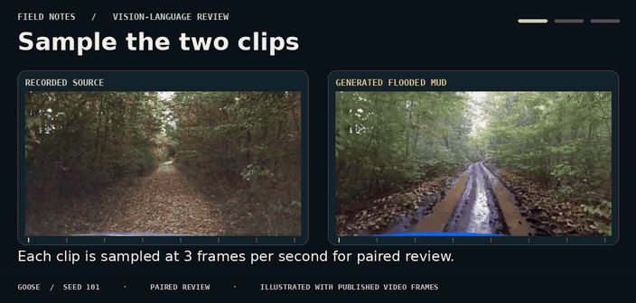
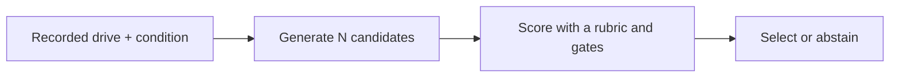

<div align="center">

# How Do You Test Weather You Cannot Schedule?

### A visual lesson on verifier-guided test-time scaling for generative video

Alicia Chua · Pawarit Laosunthara · Eric Tang &nbsp;|&nbsp; Anyscale

[](https://neurips-education-track.github.io/2026/)
[](https://cut-ai-edu.pages.dev/)
[](START_HERE.md)
[](LICENSE_CONTENT_CC-BY-4.0.txt)
[](LICENSE_CODE_APACHE-2.0.txt)

<a href="interactive/media/montage-rain-fog-night-clear.mp4"></a>

*One recorded drive, four skies. The road, the cars, and the camera path come from the real recording; only the weather changes.*

### [▶ Open the live lesson](https://cut-ai-edu.pages.dev/) &nbsp;·&nbsp; [Read the 2-page paper](paper/cut_neurips2026_education.pdf) &nbsp;·&nbsp; [Teach it in class](interactive/teaching.html) &nbsp;·&nbsp; [Regenerate on H100 or B200](generation/docker/README.md)

</div>

## The lesson in three moves

<table>
<tr>
<td width="33%" align="center"><br><b>1. Vote</b><br>Two fog takes from the same drive, prompt, and settings. Only the seed differs. Which would you keep, and why?</td>
<td width="33%" align="center"><br><b>2. Scale N</b><br>Grow the pool from 1 to 8 candidates. A balanced rubric picks Take 04. Fog intensity alone picks the smoke-like plume in Take 07.</td>
<td width="33%" align="center"><br><b>3. Audit the judge</b><br>Follow a recorded review by Qwen3-VL-32B-Instruct. It notes an invented hood, then scores structure 5/5.</td>
</tr>
</table>

> **Generation creates options. The selector turns options into a decision.**

## One method, five sources

<div align="center">


*Real footage (left) and Cosmos Transfer 2.5 output (right) for city streets (Boreas), off-road tracks (GOOSE, TartanDrive 2.0), a walking robot (GrandTour), and web video (Wikimedia Commons). Credits and licenses are in each clip's footer.*
</div>

## Start in 60 seconds

1. Open the [live interactive lesson](https://cut-ai-edu.pages.dev/).
2. Watch a recorded street, its edge guide, and a generated fog clip. Ask what should stay fixed when the weather changes.
3. Vote between two fog candidates before seeing any score.
4. Increase the candidate budget from N=1 to N=8 and compare a balanced rubric with fog intensity alone.
5. Set the minimum street fidelity to 97 and explain why the selector keeps no clip.
6. Follow a recorded paired review by a vision-language model and decide whether its observation supports its score.

The whole lesson also runs offline from `interactive/`.

## The idea

Rare driving conditions are difficult to capture safely, repeatedly, and on demand. A controllable world-generation model can transform one recorded drive into several candidate videos while spatial guidance helps preserve the road layout and object placement.

*Inference* is the stage when a trained model produces an output. *Test-time scaling* spends additional computation at this stage. Here, the extra computation samples N candidates from a fixed generator, and only the random seed changes. A verifier scores each candidate against an application rubric, hard gates exclude candidates that fail a requirement, and the selector keeps the best survivor or abstains.

> Generation creates options. The selector turns options into a decision.

A larger pool offers more chances to find a useful clip and more chances to exploit a weak score. Increasing N is useful only when both the candidate distribution and the selection rule are fit for purpose.



This resource uses NVIDIA Cosmos Transfer 2.5 as a worked implementation. Eight fog candidates are generated from the same source, prompt, parameters, and edge control, with only the random seed changing.

## The lesson pages

| Page | Use it for |
| --- | --- |
| `interactive/index.html` | The full lesson: framing, fog vote, candidate budget, selector and gates, judge lab, transfer to rain and snow |
| `interactive/present.html` | Projector mode for a poster or classroom: six stops, arrow keys, nothing advances on a timer |
| `interactive/teaching.html` | Teaching and reuse: five-minute, self-guided, and classroom routes, facilitation prompts, assessment guidance, printable worksheet |
| `interactive/evidence.html` | Evidence lab: recorded judge responses, documented failure cases, measured timings, and sources |

Want more? The online [Paint the Trail Gallery](https://paint-the-trail-gallery.pages.dev/) has 146 more renders across 31 real drives, each with its prompt and judge scores. It is optional. The fog exercise, selector, and recorded judge cases work offline.

To use the lesson offline:

```bash
python -m http.server 8000
```

Open `http://localhost:8000/interactive/`. The core lesson needs no account, network connection, GPU, model download, or Python package installation.

## Where the scores come from

The fog exercise uses **fixed illustrative annotations** based on visual inspection. Learners can inspect each candidate's observation, score rationale, and weighted calculation. The numbers make the selection rule observable and editable; they are not ground truth or benchmark measurements.

A separate judge lab follows recorded reviews by Qwen3-VL-32B-Instruct, an open vision-language model: the sampled frames, the question it was asked, and its saved answer. No model runs in the browser. In one frost-at-dawn case, the judge lists an added striped hood yet scores structure preservation 5/5, which shows why a text observation, a numerical rating, and a retention decision can disagree.

Run the dependency-free selector:

```bash
python source/scoring.py --n 8
python source/scoring.py --n 8 --weather 100 --structure 0 --stability 0
python source/scoring.py --n 8 --reject take07
```

The optional notebook `notebooks/selector_lab.ipynb` examines candidate budget, mission-dependent weights, proxy failure, and rating uncertainty without regenerating video.

## Regenerate the video candidates

The `generation/` directory contains the Ray execution wrapper, experiment definitions, and driver-side tests used to launch independent Cosmos Transfer 2.5 samples in parallel. It does not include model weights.

**On NVIDIA H100 or B200 GPUs**, use the container image in [`generation/docker/`](generation/docker/README.md). It bundles Ray 2.60, Python 3.13, CUDA 13, the Cosmos Transfer 2.5 source at the recorded revision, and its Python environment. You provide a Hugging Face token with access to the Cosmos model.

```bash
docker build -f generation/docker/Dockerfile -t cut-cosmos:cu130 .
```

Then follow [`generation/docker/README.md`](generation/docker/README.md) to download the source clip, start the container, and run the experiments.

**On an existing Ray cluster**, see [`generation/README.md`](generation/README.md).

The recorded lesson run used Cosmos source revision `2ff49d0`, the `edge/distilled` configuration, 4 denoising steps, guidance 4, 93 frames, edge weight 0.65, and four NVIDIA L40S GPUs. The exact model-weight revision was not recorded, so byte-identical regeneration is not claimed. Guardrails are enabled by default.

## Repository map

| Path | Contents |
| --- | --- |
| `interactive/` | Self-contained browser lesson (v33), projector mode, teaching page, evidence lab, and compressed media |
| `paper/` | Camera-ready two-page paper (PDF and LaTeX source, official NeurIPS 2026 template) |
| `docs/` | Teaching guide, worksheet, answer key, rubric, accessibility, provenance, and reproducibility notes |
| `data/` | Fixed illustrative selector annotations |
| `notebooks/` | Hardware-free selector analysis |
| `source/` | Compact scoring example, lesson configurations, and sanitized manifests |
| `generation/` | Cosmos Transfer 2.5 and Ray execution wrapper, configs, tests, and the H100/B200 container image |
| `pdf/` | Printable teaching guide, worksheet, and answer key |
| `references/` | Research and implementation references |

## Suggested paths

| If you are... | Start here | Time |
| --- | --- | ---: |
| A first-time learner | [Live lesson](https://cut-ai-edu.pages.dev/) | 5 to 15 min |
| Presenting at a poster or in class | `interactive/present.html` | 5 min |
| An educator | `interactive/teaching.html`, [teaching guide](docs/TEACHING_GUIDE.md), [worksheet](docs/LEARNER_WORKSHEET.md) | 15 to 40 min |
| Reviewing the selector | [Rubric and scoring](docs/RUBRIC_AND_SCORING.md) and [notebook](notebooks/selector_lab.ipynb) | 15 min |
| Checking evidence | `interactive/evidence.html`, [reproducibility record](docs/REPRODUCIBILITY.md), [media provenance](docs/MEDIA_PROVENANCE.md) | 10 min |
| Regenerating candidates | [H100/B200 container](generation/docker/README.md) or [Ray cluster guide](generation/README.md) | Environment dependent |

## Scope and limitations

This is an educational demonstration of generation, evaluation, and selection. It is not an autonomous-driving benchmark, a validated AV evaluator, a claim of physical realism, or a vehicle-safety certification. No downstream perception or planning system was evaluated. Estimating verifier error requires independent labels; improved performance on real drives has not been established. The small example pool and illustrative annotations should be inspected, challenged, and replaced when adapting the lesson to another application.

## Upstream resources

- [NVIDIA Cosmos Transfer 2.5 source](https://github.com/nvidia-cosmos/cosmos-transfer2.5)
- [NVIDIA Cosmos Transfer 2.5 model page](https://huggingface.co/nvidia/Cosmos-Transfer2.5-2B)
- [Full references](references/REFERENCES.bib)

## License and attribution

Original educational content is licensed under CC BY 4.0. Original code is licensed under Apache 2.0. Third-party software, model materials, source media, generated media, names, and trademarks remain subject to their applicable upstream terms. Clips derived from GOOSE, GrandTour, and some Wikimedia Commons files are CC BY-SA 4.0. See [LICENSE_SCOPE.md](LICENSE_SCOPE.md), [THIRD_PARTY_NOTICES.md](THIRD_PARTY_NOTICES.md), and [docs/MEDIA_PROVENANCE.md](docs/MEDIA_PROVENANCE.md).
