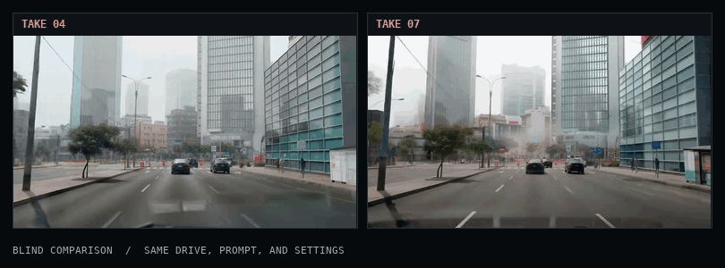
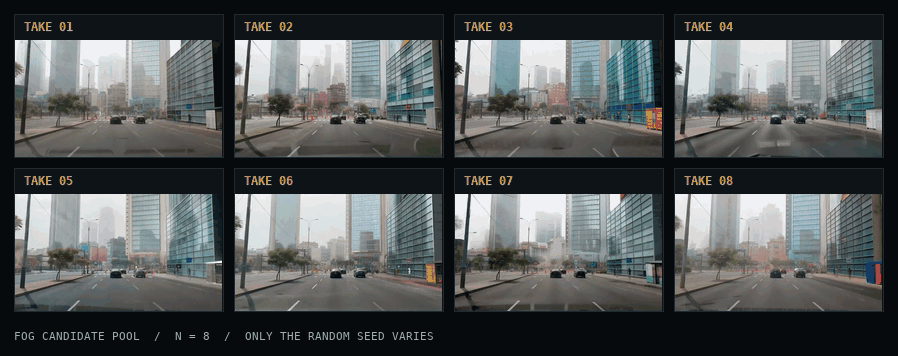
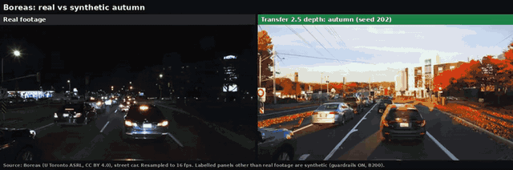
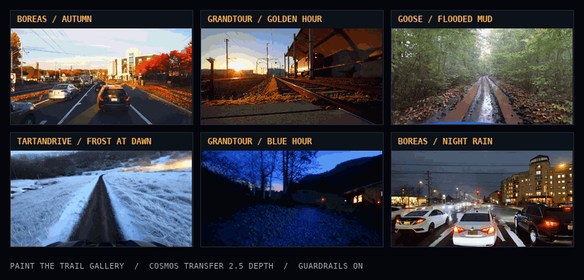

<div align="center">

# How Do You Test Weather You Cannot Schedule?

### A Visual Lesson on Verifier-Guided Test-Time Scaling for Generative Video

Alicia Chua, Pawarit Laosunthara, and Eric Tang · Anyscale

[](https://neurips-education-track.github.io/2026/)
[](https://cut-ai-edu.pages.dev/)
[](START_HERE.md)
[](LICENSE_CONTENT_CC-BY-4.0.txt)
[](LICENSE_CODE_APACHE-2.0.txt)

<a href="interactive/media/montage-rain-fog-night-clear.mp4"></a>

*A recorded urban drive rendered under four conditions with NVIDIA Cosmos Transfer 2.5. Road layout, vehicles, and camera motion follow the source recording.*

[Interactive lesson](https://cut-ai-edu.pages.dev/) &nbsp;|&nbsp; [Paper (PDF)](paper/cut_neurips2026_education.pdf) &nbsp;|&nbsp; [Teaching guide](https://cut-ai-edu.pages.dev/teaching) &nbsp;|&nbsp; [Paint the Trail Gallery](https://paint-the-trail-gallery.pages.dev/) &nbsp;|&nbsp; [Regeneration on H100 and B200](generation/docker/README.md)

</div>

## Overview

Rare driving conditions such as dense fog, heavy snow, or low-sun glare are difficult to record safely and on demand. Controllable video generation models can restage a recorded drive under a requested condition while spatial guidance preserves the scene layout. Individual samples nevertheless vary in how well they express the condition, preserve structure, and remain stable over time.

This resource teaches **verifier-guided test-time scaling** for generative video. Test-time scaling spends additional computation at inference. In this lesson, the additional computation produces N candidate videos from a fixed generator, varying only the random seed. A verifier scores each candidate against an application rubric, hard gates remove candidates that fail a requirement, and the selector retains the highest-scoring eligible candidate or abstains when none qualifies.

Learners examine how the candidate budget, the rubric weights, and the gate thresholds determine the final selection, and how an incomplete scoring criterion can favor an undesirable candidate as N grows.

## Lesson walkthrough

<table>
<tr>
<td width="50%"></td>
<td width="50%"></td>
</tr>
<tr>
<td><b>Blind comparison.</b> Learners compare two fog candidates generated from the same drive, prompt, and settings, and record a choice before any score is shown.</td>
<td><b>Candidate budget.</b> The pool grows from N = 1 to N = 8. A balanced rubric selects Take 04; a rubric weighted only on fog intensity selects Take 07, which shows a localized smoke-like plume.</td>
</tr>
</table>

<div align="center">

</div>

**Verifier audit.** The judge lab follows a recorded paired review by Qwen3-VL-32B-Instruct: the sampled frames, the evaluation prompt, and the saved response. In a documented frost-at-dawn case, the model lists an added striped hood as a new object and still rates structure preservation 5 out of 5. Learners inspect the matched frames and decide whether a gate on added foreground objects should exclude the clip.

## Recorded comparisons across datasets

<div align="center">

</div>

The evidence section of the lesson includes recorded comparisons generated with Cosmos Transfer 2.5 depth control from five public sources: urban driving (Boreas), off-road driving (GOOSE, TartanDrive 2.0), a legged robot (GrandTour), and web video (Wikimedia Commons). Each clip carries its source credit and license in the footer.

## Paint the Trail Gallery

<div align="center">
<a href="https://paint-the-trail-gallery.pages.dev/"></a>
</div>

The [Paint the Trail Gallery](https://paint-the-trail-gallery.pages.dev/) is an optional companion to the lesson. It presents 146 renders from 31 recorded drives across five sources (TartanDrive 2.0, Boreas, GOOSE, GrandTour, and Wikimedia Commons) under nine conditions, including fog, blizzard, night rain, frost at dawn, and flooded mud.

Visitors select a dataset, a drive, and a condition, then compare the generated clip with the recorded footage using a sliding divider. Each render is shown with:

- the prompt sent to Cosmos Transfer 2.5, with the seed and generation time;
- the automated judge scores from Qwen3-VL-32B-Instruct for the blind pass (photorealism, physical plausibility, temporal consistency, overall) and the paired pass (structure preservation, condition achieved, semantic consistency), each with its definition;
- the judge's observed weather and light, implausible elements, contradictions, and paired verdict;
- the judge instructions in full, with the target condition description for the selected weather.

All renders use Cosmos Transfer 2.5 with depth control, 35 steps, and guardrails enabled, generated on NVIDIA B200 GPUs. Each drive and condition was rendered with seeds 101, 202, and 303; the gallery shows the seed selected by visual review and excludes renders with a documented failure or a judge score below 4. The Wikimedia Commons clips were reviewed visually and were not scored by the judge.

## Getting started

**Online.** Open [cut-ai-edu.pages.dev](https://cut-ai-edu.pages.dev/).

**Offline.** From the repository root:

```bash
python -m http.server 8000
```

Then open `http://localhost:8000/interactive/`. The lesson requires no account, network connection, GPU, model download, or package installation.

| Page | Online | Purpose |
| --- | --- | --- |
| `interactive/index.html` | [Open](https://cut-ai-edu.pages.dev/) | Full lesson: problem framing, blind comparison, candidate budget, selector and gates, judge lab, and transfer to rain and snow |
| `interactive/present.html` | [Open](https://cut-ai-edu.pages.dev/present) | Projector mode for poster sessions and classrooms, with six stops controlled by the arrow keys |
| `interactive/teaching.html` | [Open](https://cut-ai-edu.pages.dev/teaching) | Teaching routes of 5, 15, and 30 to 40 minutes, facilitation prompts, assessment guidance, and a printable worksheet |
| `interactive/evidence.html` | [Open](https://cut-ai-edu.pages.dev/evidence) | Recorded judge responses, documented failure cases, measured timings, and data sources |

## Scores and annotations

The fog exercise uses fixed illustrative annotations based on visual inspection. For each candidate, learners can view the visual observation, the scoring rationale, and the weighted calculation. The annotations are illustrative values intended to support discussion of selection behavior. The recorded judge responses in the evidence section are model outputs and are reported separately from the illustrative scores. The browser displays saved responses only.

The selector can also be run from the command line without dependencies:

```bash
python source/scoring.py --n 8
python source/scoring.py --n 8 --weather 100 --structure 0 --stability 0
python source/scoring.py --n 8 --reject take07
```

The notebook `notebooks/selector_lab.ipynb` examines candidate budget, rubric weights, proxy failure, and rating uncertainty without generating video.

## Regenerating the candidates

The `generation/` directory contains the Ray execution wrapper, experiment definitions, and driver-side tests used to run independent Cosmos Transfer 2.5 samples in parallel. Model weights are downloaded separately at run time.

**NVIDIA H100 and B200.** The container in [`generation/docker/`](generation/docker/README.md) packages Ray 2.60, Python 3.13, CUDA 13, the Cosmos Transfer 2.5 source at the recorded revision, and its Python environment. A Hugging Face token with access to the Cosmos model is required at run time.

```bash
docker build -f generation/docker/Dockerfile -t cut-cosmos:cu130 .
```

The [container guide](generation/docker/README.md) covers the source clip download, container launch, and experiment runs. For an existing Ray cluster, see [`generation/README.md`](generation/README.md).

**Recorded configuration.** Cosmos Transfer 2.5 source revision `2ff49d0`, `edge/distilled`, 4 denoising steps, guidance 4, 93 frames, edge weight 0.65, guardrails enabled, four NVIDIA L40S GPUs. The model-weight revision was not recorded; regenerated outputs may differ from the published candidates.

## Repository structure

| Path | Contents |
| --- | --- |
| `interactive/` | Browser lesson (v33), projector mode, teaching page, evidence section, and compressed media |
| `paper/` | Camera-ready paper in the official NeurIPS 2026 template, with LaTeX source |
| `docs/` | Teaching guide, worksheet, answer key, rubric, accessibility, provenance, and reproducibility notes |
| `data/` | Illustrative selector annotations |
| `notebooks/` | Selector analysis notebook |
| `source/` | Scoring script, lesson configurations, and sanitized generation manifests |
| `generation/` | Cosmos Transfer 2.5 and Ray execution wrapper, configurations, tests, and the H100 and B200 container |
| `pdf/` | Printable teaching guide, worksheet, and answer key |
| `references/` | Research and implementation references |

## Recommended starting points

| Role | Starting point | Time |
| --- | --- | ---: |
| Learner | [Interactive lesson](https://cut-ai-edu.pages.dev/) | 5 to 15 min |
| Presenter | [Projector mode](https://cut-ai-edu.pages.dev/present) | 5 min |
| Instructor | [Teaching page](https://cut-ai-edu.pages.dev/teaching), [teaching guide](docs/TEACHING_GUIDE.md), [worksheet](docs/LEARNER_WORKSHEET.md) | 15 to 40 min |
| Reviewer of the selector | [Rubric and scoring](docs/RUBRIC_AND_SCORING.md), [notebook](notebooks/selector_lab.ipynb) | 15 min |
| Reviewer of the evidence | [Evidence page](https://cut-ai-edu.pages.dev/evidence), [reproducibility record](docs/REPRODUCIBILITY.md), [media provenance](docs/MEDIA_PROVENANCE.md) | 10 min |
| Practitioner regenerating media | [H100 and B200 container](generation/docker/README.md), [Ray cluster guide](generation/README.md) | Varies |

## Scope

This resource demonstrates generation, evaluation, and selection for educational purposes. It makes no claims about autonomous-driving performance, physical realism, or vehicle safety, and no downstream perception or planning system was evaluated. Estimating verifier error requires independent labels. Instructors adapting the lesson to another application should replace the example pool and annotations with material from that application.

## Related work

The lesson connects to recent work on verifier-guided video search (Video-T1, ICCV 2025), inference-time scaling for diffusion models (Ma et al., CVPR 2025), video reward models from human feedback (NeurIPS 2025), application-driven video judging (WorldModelBench, NeurIPS 2025), verifier imperfection in test-time scaling (ROC-n-reroll, ICLR 2026), and coverage and reward hacking in inference-time alignment (ICML 2025). Full references are in [`references/REFERENCES.bib`](references/REFERENCES.bib).

Upstream resources: [Cosmos Transfer 2.5 source](https://github.com/nvidia-cosmos/cosmos-transfer2.5) · [Cosmos Transfer 2.5 model](https://huggingface.co/nvidia/Cosmos-Transfer2.5-2B) · [Ray documentation](https://docs.ray.io/)

## Citation

```bibtex
@inproceedings{chua2026weather,
  title     = {How Do You Test Weather You Cannot Schedule? A Visual Lesson on Verifier-Guided Test-Time Scaling for Generative Video},
  author    = {Chua, Alicia and Laosunthara, Pawarit and Tang, Eric},
  booktitle = {NeurIPS 2026 Education Track},
  year      = {2026},
  url       = {https://cut-ai-edu.pages.dev/}
}
```

## License and attribution

Original educational content is licensed under CC BY 4.0 and original code under Apache 2.0. Third-party software, model materials, source media, generated media, names, and trademarks remain subject to their upstream terms. Clips derived from GOOSE, GrandTour, and some Wikimedia Commons files are licensed CC BY-SA 4.0. See [LICENSE_SCOPE.md](LICENSE_SCOPE.md), [THIRD_PARTY_NOTICES.md](THIRD_PARTY_NOTICES.md), and [docs/MEDIA_PROVENANCE.md](docs/MEDIA_PROVENANCE.md).
